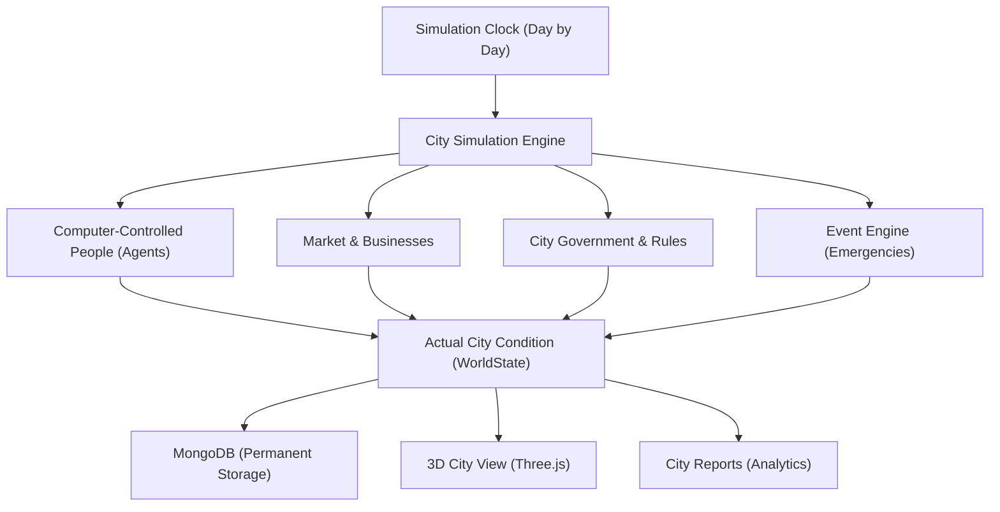

# MANNORA — Virtual City Simulation

> **Virtual City Simulation with Computer-Controlled People, Dynamic Economy, and 3D Visual Display**  
> *(Formerly Neural City)*

---

## 1. What is MANNORA?

**MANNORA** is a full-stack virtual city simulation project. In this virtual city:
- **Computer-controlled people (Agents)** live, work, earn salaries, buy food, make friends, and follow daily routines.
- A **Dynamic Market Economy** calculates the real price of food, water, electricity, and materials based on supply and demand.
- A **City Government** collects taxes, provides public services (hospitals, schools, buses), and passes rules.
- An **Interactive 3D View** renders actual buildings, roads, and people moving around in real time using Three.js.
- An **AI City Assistant** explains what is happening in the city in plain English and gives policy suggestions.
- A **Time Machine** lets you pause, rewind to past days, or create "what if" test versions of the city.

This project was built so that any college student or software engineer can easily understand, demonstrate, and explain the principles of:
1. Object-Oriented Simulation Engines
2. Deterministic Execution & Repeatability
3. Microeconomic & Macroeconomic loops
4. Full-stack Web Development with React, Node.js, and MongoDB

---

## 2. Why We Are Building It

Modern city systems (like electricity grids, food delivery, job markets, and tax policies) are deeply connected. When one thing changes—like water getting scarce—everything else is affected:
1. Water prices go up.
2. People spend more on daily needs and less on leisure.
3. Businesses face higher costs.
4. Public satisfaction drops.

Instead of writing simple calculators, **MANNORA simulates every single person and business step by step**, allowing students and researchers to see how high-level city statistics emerge naturally from individual choices.

---

## 3. How the Virtual City Works



1. **Simulation Clock**: Advances the city tick by tick (representing days or hours). Every step uses a deterministic random seed so that the simulation gives the exact same result if replayed.
2. **People (Agents)**: Each person has health, energy, happiness, money, a job, and personal memories. Every day they decide whether to work, rest, buy groceries, or spend time with friends.
3. **Economy & Markets**: Prices are not hardcoded. When grain is abundant, bread is cheap; during a drought, bread prices rise automatically.
4. **Government**: Collects taxes and funds public utilities like clean water, healthcare, and schools.
5. **Time Machine**: Takes snapshots of the entire city. You can rewind to an earlier day or branch into a test version to ask: *"What if we made water free from Day 50 onwards?"*

---

## 4. Key Features & Simple Names

| Feature in Project | User-Friendly Name | What It Does |
|---|---|---|
| **City Overview** | World Dashboard | Shows main city metrics: population, bank balance, power, and recent events |
| **3D City View** | 3D Spatial Canvas | Real-time 3D display showing buildings, districts, roads, and moving citizens |
| **Manage People** | Citizen Inspector | View any citizen's job, health, happiness, money, goals, and recent memories |
| **City Economy** | Economy & Market Lab | Reports on total production (GDP), unemployment, item prices, and business profit |
| **Government Rules** | Civic Governance | Adjust income tax, manage hospitals and schools, and apply city rules |
| **Time Machine** | Temporal Timeline | Rewind simulation time, restore saved snapshots, and test different decisions |
| **Event Engine** | Emergency Events | Inject events like water shortages or power cuts and watch the city respond |
| **AI City Assistant** | AI World Analyst | Explains city statistics and citizen thoughts in simple English |

---

## 5. Technology Stack

- **Frontend**: React 18, Vite, Tailwind CSS, Lucide Icons, Framer Motion
- **3D Graphics**: Three.js, React Three Fiber (`@react-three/fiber`), Drei (`@react-three/drei`)
- **Backend API**: Node.js, Express.js
- **Database**: MongoDB with Mongoose ODM
- **Simulation Engine**: Custom JavaScript ES Modules (`simulation/`) with deterministic Mulberry32 PRNG
- **AI Integration**: Modular provider architecture with rule-based fallback and Gemini / OpenAI LLM support

---

## 6. Project Folder Structure

```
MANNORA/
├── client/              # React 18 frontend with 3D viewer, dashboard, and reports
│   └── src/
│       ├── components/  # Reusable UI widgets, panels, 3D canvas, event modals
│       ├── pages/       # Dashboard, Simulation 3D, People, Reports, Government, Time Machine
│       └── services/    # REST API callers connecting frontend to backend
├── server/              # Express API server connecting to MongoDB
│   ├── controllers/     # Handlers for world, citizen, and simulation routes
│   ├── models/          # Mongoose database models (World, Agent, Snapshot)
│   └── routes/          # Express route definitions (/api/worlds, /api/agents)
├── simulation/          # Pure simulation engine code (no UI, fast execution)
│   ├── engine/          # SimulationEngine, SimulationClock, StateManager
│   ├── agents/          # Agent logic: needs, jobs, daily decisions, memory
│   ├── economy/         # Market prices, businesses, employment, taxes
│   └── events/          # EventEngine, event queue, propagation cascade
├── ai/                  # AI assistant, memory retrieval, and simple English responses
├── shared/              # Common constants, data structures, and types
└── docs/                # Detailed guides, architecture, and Simple English Glossary
```

---

## 7. How to Install and Run

### Step 1: Clone and Install Dependencies
```bash
git clone https://github.com/SiddharthOm2804/MANNORA.git
cd MANNORA
npm install
```

### Step 2: Set Up Environment Variables
Create a `.env` file in the root directory (or copy `.env.example`):
```bash
cp .env.example .env
```
Ensure your MongoDB is running locally at `mongodb://localhost:27017/neural_city` or set your cloud MongoDB connection string.

### Step 3: Start the Backend Server
```bash
npm run dev:server
```
The Express server starts on `http://localhost:5000`.  
Check server health: `http://localhost:5000/api/health`

### Step 4: Start the Frontend Application
In a new terminal window:
```bash
npm run dev:client
```
Open your browser and visit: `http://localhost:5173`

---

## 8. Running Automated Tests

MANNORA includes unit and integration tests for the simulation engine and AI modules:
```bash
# Test the core city simulation mechanics
npm run test:simulation

# Test AI providers and memory retrieval
npm run test:ai

# Build the frontend production bundle
npm --workspace=@neural-city/client run build
```

---

## 9. Viva and College Presentation Guide

When presenting MANNORA to examiners or interviewers, highlight these 4 core design strengths:

1. **"The UI does not fake numbers."**  
   Every statistic on the screen (unemployment, bread prices, city bank balance) is computed by the simulation engine in code, not randomly generated by a UI timer.
2. **"The simulation is deterministic."**  
   If you run the simulation with seed `83917492` for 100 days twice, you will get the exact same population and economy down to the last decimal.
3. **"Events cascade through actual systems."**  
   When a "Water Shortage" is injected, the engine reduces actual water reserves, which triggers price hikes in the market, forces poorer citizens to cut back, lowers public health, and reduces government approval.
4. **"The Time Machine allows scientific testing."**  
   You can take a snapshot of the city on Day 50, create Branch A (high tax) and Branch B (low tax), run both for 50 more days, and scientifically compare which policy produced happier citizens.

For full word explanations and definitions, please read:  
[`docs/SIMPLE_ENGLISH_GLOSSARY.md`](file:///Users/siddharthom/Documents/MANNORA/docs/SIMPLE_ENGLISH_GLOSSARY.md)
