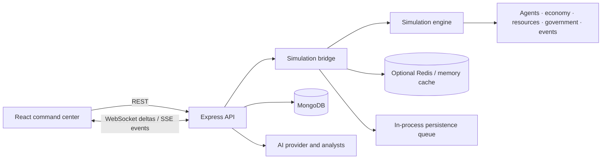

# MANNORA (formerly NEURAL CITY)

MANNORA is an experimental, full-stack civilization simulator. It combines a deterministic JavaScript simulation engine, autonomous rule-driven agents, economic and civic systems, optional language-model analysis, private persistent worlds, and a React 3D command center.

The project exists to make interactions between individual behavior and city-scale outcomes inspectable. A change to resources, policy, or an external event can be followed through agents, markets, government, and aggregate metrics. It is a research and education prototype, not a validated forecasting tool for real-world policy.

## Contents

1. [Architecture](#architecture)
2. [Simulation engine](#simulation-engine)
3. [Multi-agent system](#multi-agent-system)
4. [AI layer](#ai-layer)
5. [3D visualization](#3d-visualization)
6. [Counterfactual engine](#counterfactual-engine)
7. [Experiment system](#experiment-system)
8. [Deployment](#deployment)
9. [Screenshots and demo](#screenshots-and-demo)
10. [Future research directions](#future-research-directions)
11. [Security and city management](#security-and-city-management)

## Architecture

The repository is an npm-workspaces monorepo. `client/` is a React/Vite application, `server/` is an Express API and WebSocket gateway, `simulation/` contains the domain engine, `ai/` contains provider and analyst abstractions, and `shared/` holds common constants and event types. MongoDB stores worlds, agents, and periodic summary snapshots. Redis is optional; the server falls back to a bounded in-process cache.



See [docs/architecture.md](docs/architecture.md) for component boundaries and operational limits.

## Simulation engine

`SimulationEngine` advances a `WorldState` in discrete ticks using a seeded `RandomEngine`. Default systems run in priority order: events, agents, economy, government, resources, population, buildings, then metrics. Each tick clones current state, applies system updates, commits to bounded in-memory history, and publishes a serialized state event. The engine can run synchronously one step at a time or use its clock loop.

Simulation state and API orchestration currently live in one Node process. Periodic database snapshots are summaries rather than complete engine checkpoints; restarting the server does not guarantee exact restoration of an active run. See [docs/simulation-engine.md](docs/simulation-engine.md).

## Multi-agent system

Citizens maintain needs, goals, health, social relations, economic state, and memory. Rule-based decision systems are used on the per-tick path so runs remain bounded and repeatable. Agent updates share the seeded random stream. The Three.js client renders a capped subset of agents; it is a visualization, not a persistence or simulation authority. Details: [docs/agent-system.md](docs/agent-system.md).

## AI layer

The `ai/` workspace provides provider contracts, a deterministic fallback, citizen/government/analyst helpers, prompt parsing, and causal analysis. External model calls are optional, configured on the server, bounded by a request timeout, and fall back to deterministic rules on provider failure. API keys must never use a `VITE_` prefix or be placed in client code. LLM output is advisory and does not run inside the simulation tick loop. Details: [docs/ai-system.md](docs/ai-system.md).

## 3D visualization

The client uses React Three Fiber, Three.js, and Drei for terrain, saved city districts, persisted facilities, road context, resource producers, and instanced citizen markers. Saved cities and buildings are sourced from the world record. Exact road/parcel/citizen distribution is not persisted yet, so roads and vegetation remain representative scenery. Agent instance rendering is capped at 1,500 to bound draw work. Browser/WebGL memory still depends on the device and scene size.

## Counterfactual engine

The time-machine modules support bounded in-memory snapshots, rollback, named branches, and counterfactual comparisons. These are useful for controlled experiments within a running process. They are not durable distributed branches, and the current database summary snapshots are insufficient for exact restart recovery. Review [docs/simulation-engine.md](docs/simulation-engine.md) before treating results as reproducible archival records.

## Experiment system

`ExperimentRunner` and `ExperimentLab` execute named simulation scenarios and produce comparative summaries/statistics. Configure the seed, baseline, policy/event changes, and run length explicitly. Experiment history is currently held by the bridge process; export or persist results externally before restarting a deployment. This prototype does not establish scientific validity for a model without calibration and sensitivity analysis.

## Deployment

### Requirements

- Node.js 20 or later (ES modules and built-in `fetch` are used)
- npm 10 or compatible npm workspaces support
- MongoDB for world storage and production operation
- Redis is optional

### Local development

```bash
npm install
cp .env.example .env
# Set MONGO_URI to a local or managed MongoDB instance.
npm run dev:server
# In another terminal:
npm run dev:client
```

The API defaults to `http://localhost:5000`; Vite serves the UI on `http://localhost:5173` and proxies `/api` and `/ws` to the API. The server can start without MongoDB in development, but database-backed endpoints will fail. Use the root scripts `npm run build:client`, `npm test`, and `npm run test:server` as appropriate.

### Environment

| Variable | Required | Purpose |
|---|---:|---|
| `NODE_ENV` | production | Set to `production` for deployment safeguards |
| `PORT` | no | HTTP port (default `5000`) |
| `MONGO_URI` | production | MongoDB connection string; production startup fails without it |
| `CLIENT_URL` | no | Single allowed browser origin (default local Vite origin) |
| `CORS_ORIGINS` | no | Comma-separated allowed origins; takes precedence over `CLIENT_URL` |
| `COOKIE_SAME_SITE` | no | Session cookie policy: `lax` (default), `strict`, or `none`; `none` requires HTTPS in production |
| `TRUST_PROXY` | deployment-specific | Set `true` only behind one trusted reverse proxy |
| `REDIS_URL` | no | Redis connection string; do not log or expose it |
| `AI_PROVIDER` | no | `fallback`, `openai`, `anthropic`, or compatible HTTP provider |
| `AI_API_KEY` / `OPENAI_API_KEY` | no | Server-only provider credential |
| `AI_BASE_URL` | no | Provider endpoint; only set to a trusted endpoint |
| `AI_MODEL` | no | Provider model identifier |
| `VITE_API_URL` | hosted client | Public API base URL compiled into the browser bundle; never put secrets here |

Production requires MongoDB. Account sessions use HttpOnly cookies and CSRF-protected mutations. New worlds are private to their creator; owners can grant viewer/editor access. Existing ownerless worlds remain inaccessible until an operator maps each one to the correct account. Account recovery/email verification are not implemented. The included rate limiter, simulation bridge, experiment registry and persistence queue are single-process; use shared infrastructure for multi-replica/high-availability deployment.

### Production checklist

1. Use TLS at the reverse proxy and set `CLIENT_URL` or `CORS_ORIGINS` to exact HTTPS origins.
2. Keep `.env` out of version control; use the platform secret store and rotate credentials.
3. Restrict MongoDB network access and credentials; configure backups and restore drills.
4. Set `TRUST_PROXY=true` only when one known proxy terminates traffic.
5. Configure a trusted AI provider URL and server-side key; otherwise use the deterministic fallback.
6. Complete an operator-reviewed owner mapping for every legacy world before account migration; never assign all legacy worlds to the first account.
7. Add account recovery/email verification before public account self-service; monitor health, persistence queue failures, and process restarts.
8. Build the client with `npm run build:client` and serve `client/dist` from a static host or configured web server.

## Screenshots and demo

No checked-in screenshot assets are currently provided. Start the app using the local steps above, create or select an authorized world, orbit/zoom the city, toggle a visualization layer, inspect a saved city/facility, review current supply pressure, and confirm a supported facility action. Play/pause/step/speed controls call the backend; timeline jumps require time-machine history. Add reviewed captures under `docs/screenshots/` when a release demo is recorded; avoid including credentials or private world data.

## Future research directions

- Calibrate agent decisions and city dynamics against documented empirical datasets.
- Measure sensitivity to seeds, assumptions, policy parameters, and population scale.
- Add durable, versioned full-state checkpoints and deterministic replay across releases.
- Study heterogeneous agents, network effects, and fairness outcomes with explicit metrics.
- Evaluate model-assisted analysis for factual grounding, uncertainty, and reproducibility.
- Benchmark simulation throughput, browser rendering, and long-run memory under published workloads.

## Documentation

- [Architecture](docs/architecture.md)
- [Simulation engine and time machine](docs/simulation-engine.md)
- [Agent system](docs/agent-system.md)
- [AI system](docs/ai-system.md)
- [HTTP and streaming API](docs/api.md)
- [World map and city management audit](docs/WORLD_MAP_AND_CITY_MANAGEMENT_AUDIT.md)
- [Multi-user security audit](docs/MULTI_USER_SECURITY_AUDIT.md)
- [Manual city management guide](docs/MANUAL_CITY_MANAGEMENT_GUIDE.md)

## Security and city management

Registration requires a valid email, display name and 12-character password. The API hashes passwords with scrypt, stores opaque hashed sessions, and checks a CSRF token on every authenticated mutation. `GET /api/worlds` only returns owned or shared worlds. Every `/api/worlds/:id` route, AI world-context operation, SSE stream and WebSocket handshake checks access on the server. Owners manage shares; viewers cannot mutate; editors can change world/simulation state. See [docs/api.md](docs/api.md) and the security audit for routes and migration limits.

The Command Center shows data available in the simulation and database. The only new manual management actions are three validated facility builds (energy, water, agriculture); they require confirmation, treasury/mineral checks, placement validation and an auditable history entry. Resource distribution by district, affected population, trading and other policy actions are not yet modeled, so they are not shown as available controls.
