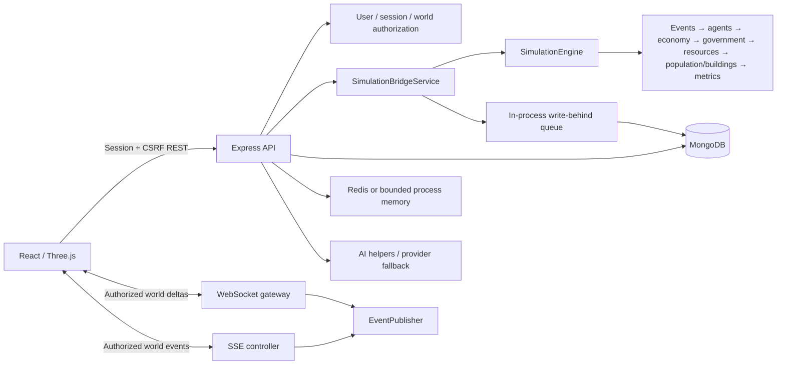

# NEURAL CITY Architecture

## Component map

| Workspace | Responsibility | Runtime |
|---|---|---|
| `client/` | React/Vite command center, dashboards, forms, reports, and Three.js scene | Browser |
| `server/` | Express REST endpoints, SSE and WebSocket delivery, world persistence, simulation bridge, cache adapter, persistence worker | Single Node.js process |
| `simulation/` | Deterministic world state, clock, agents, economy, government, resources, events, metrics, time machine, experiments | Imported by server or run in tests/CLI |
| `ai/` | Provider interface, deterministic fallback, cognitive helpers, world prompt parsing, causal and system analysis | Imported by server |
| `shared/` | Event constants and shared types/constants | Imported by packages |
| MongoDB | Durable users, sessions, worlds, agents, and summary snapshots | External service |
| Redis (optional) | Cache and publish helper when configured | External service; in-memory fallback otherwise |

## State and data flow

World records are validated through Mongoose and converted to a simulation state by `WorldStateAdapter`. `SimulationBridgeService` owns active engine instances in a process-local map. The engine publishes ticks through `EventPublisher`; the browser consumes sparse WebSocket frames or the SSE event endpoint. A persistence worker writes agent batches and summary snapshots asynchronously, while explicit checkpoints update world records.

The browser is a view and command client. It does not own authoritative simulation state. Private worlds use a server-assigned owner ID; explicit viewer/editor memberships allow sharing. REST, SSE and WebSocket paths check the current session and world access. Account recovery and email verification are not present. Legacy worlds without owner IDs fail closed and require an operator-reviewed ownership migration.

## Reliability boundaries

- The API process may start without MongoDB in development; production startup now requires a configured and reachable MongoDB.
- In-memory simulation instances, branch/experiment history, the cache fallback, rate-limit counters, and pending persistence work are lost on process termination.
- MongoDB reconnect behavior is delegated to Mongoose. Queued persistence failures are retried by retaining failed items for a later flush, but the queue is not durable and cannot guarantee recovery after process loss. The worker caps pending agent updates at 100,000, world updates at 10,000, and snapshots at 1,000; under sustained overload, oldest queued items can be evicted.
- Periodic snapshots store selected metrics and aggregate summaries, not a complete serialized engine state. A restart is not exact simulation recovery.
- Redis is an optimization and optional helper; fallback cache state is local to one process. Redis pub/sub delivery is not used to coordinate simulation ownership across replicas.
- Multi-replica operation is not supported for a given active world without shared ownership, queueing, and stream fan-out coordination.

## Security controls

The API uses Helmet, explicit CORS origins, a 1 MB body limit, JSON/form parsing limits, Mongo operator-key sanitization, process-local API/auth rate limits, opaque hashed sessions, scrypt password hashes, HttpOnly session cookies, and CSRF tokens. WebSocket upgrades enforce session/world access, allowed browser origins, connection/message limits, 16 KB payloads, and slow-client backpressure. Production error responses hide internal messages. Rate limits and simulation ownership remain process-local; multi-replica deployment needs shared rate limiting and single-writer ownership.

## Performance notes

World list queries are sorted and limited to 100 records. WebSocket deltas are computed once per published tick and shared across subscribers. Slow clients are disconnected when buffered output exceeds 1 MB. The browser renders citizens with an InstancedMesh capped at 1,500 visible instances. Simulation runtime still scales with agent count and enabled systems; benchmark representative workloads before choosing population limits.

## Runtime configuration

See the environment table and deployment checklist in [README.md](../README.md#deployment). The development Vite proxy forwards `/api` and `/ws` to the default API port 5000. Hosted clients must set a public `VITE_API_URL` and connect to a deployment that serves the WebSocket and SSE routes over TLS-compatible transports.
